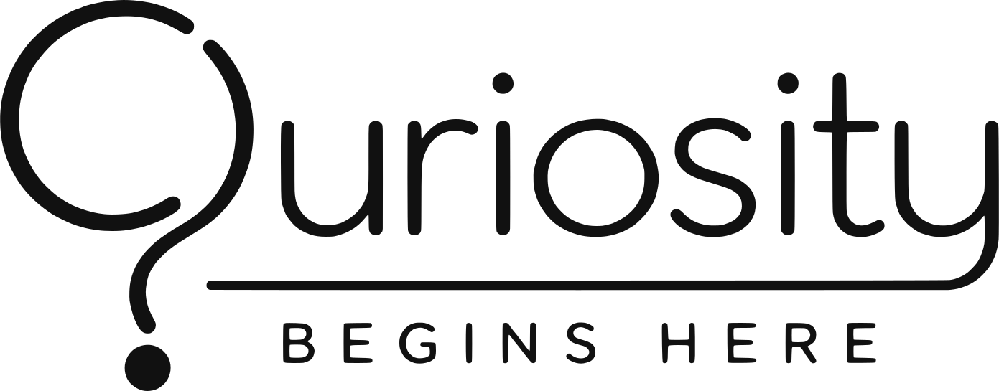
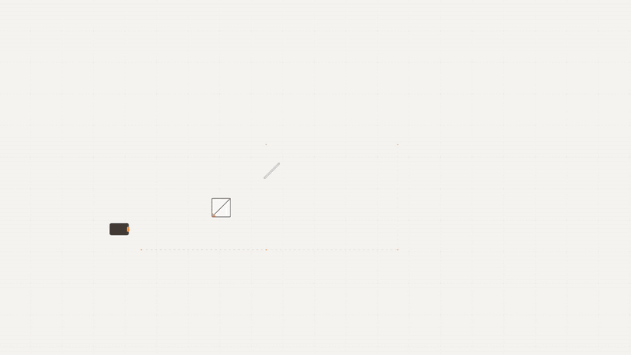
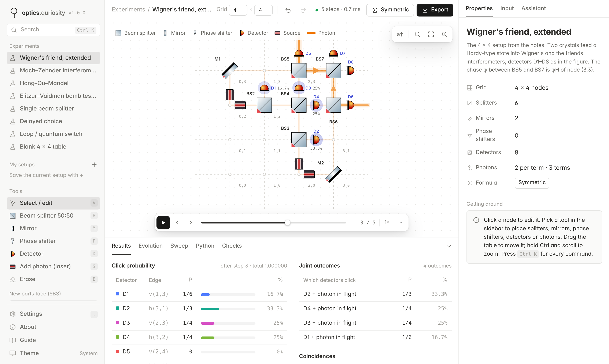
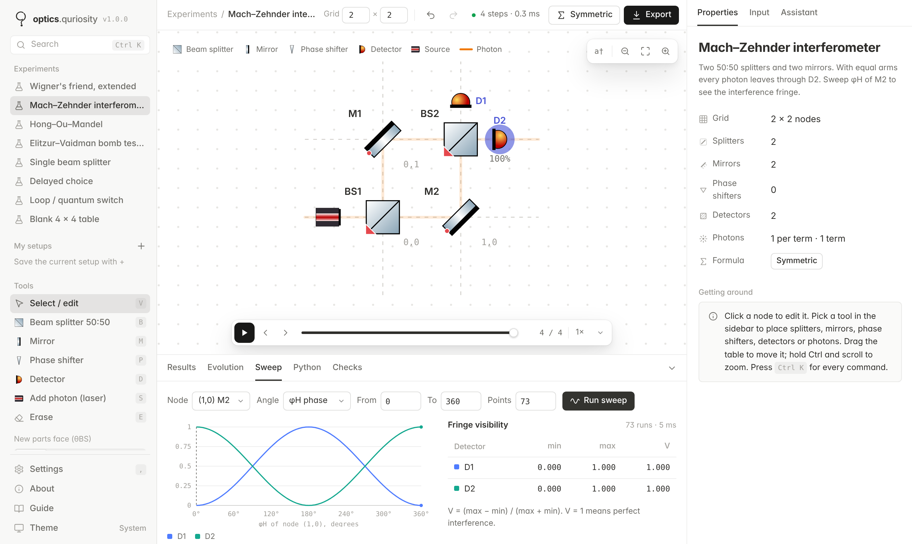
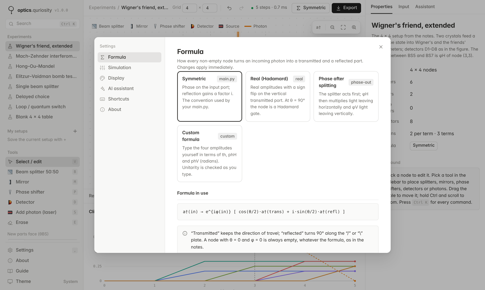
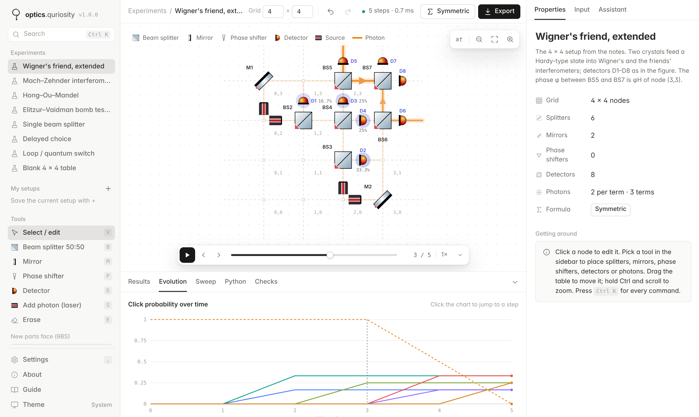
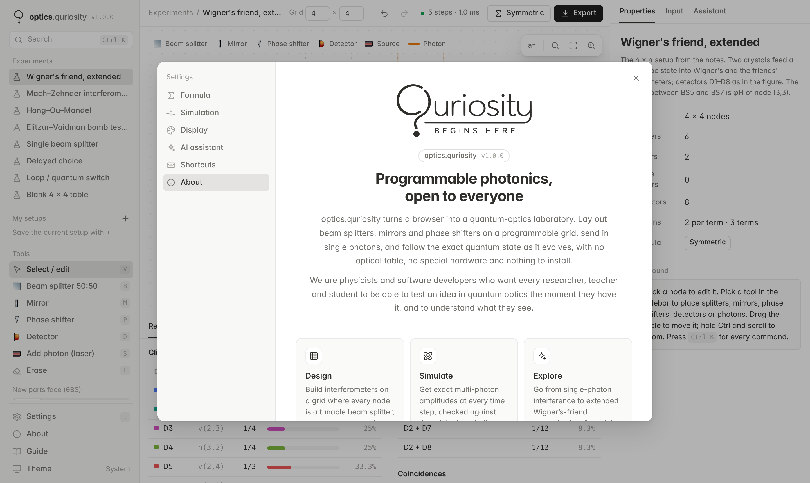
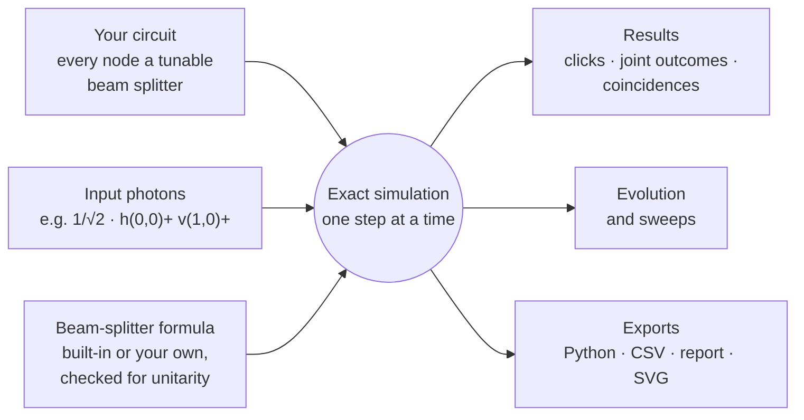
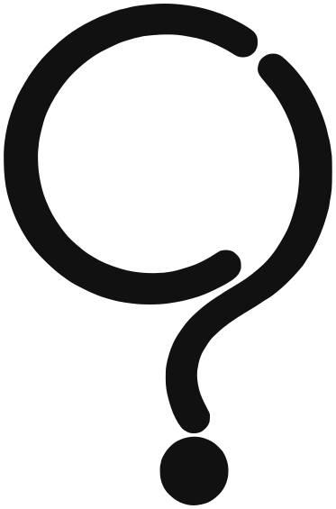

<!--
  Maintainers: to get an inline video player on this page, edit README.md on github.com,
  drag docs/media/optics-quriosity-intro.mp4 into the editor, and paste the
  https://github.com/user-attachments/... link GitHub creates on its own line under the teaser.
-->

<div align="center">

<a href="https://gurnoorsingh13.github.io/optics.quriosity/">
  <picture>
    <source media="(prefers-color-scheme: dark)" srcset="assets/brand/quriosity-logo-white.svg">
    
  </picture>
</a>

<br>

# optics.quriosity

**A quantum-optics laboratory that runs in your browser.**

Lay out beam splitters, mirrors and phase shifters on a programmable grid,<br>
send in single photons, and follow the exact quantum state as it evolves.<br>
No optical table, no special hardware, nothing to install.

<sub>A project of the <b>Quriosity group</b> · Department of Physics, Guru Nanak Dev University, Amritsar</sub>

<br>

[](https://gurnoorsingh13.github.io/optics.quriosity/)
[](https://gurnoorsingh13.github.io/optics.quriosity/docs/media/optics-quriosity-intro.mp4)

[](https://github.com/gurnoorsingh13/optics.quriosity/actions/workflows/tests.yml)
[](LICENSE)
[](assets/components/LICENSE.md)
[](CHANGELOG.md)


<br>

<a href="https://gurnoorsingh13.github.io/optics.quriosity/docs/media/optics-quriosity-intro.mp4">
  
</a>

<sub>The first 12 seconds of our introduction film. &nbsp;▶ <b><a href="https://gurnoorsingh13.github.io/optics.quriosity/docs/media/optics-quriosity-intro.mp4">Watch all 97 seconds, with sound</a></b> &nbsp;·&nbsp; <a href="docs/media/optics-quriosity-intro.mp4">download (MP4, 1080p)</a></sub>

</div>

<br>

## The idea in one picture

<p align="center">
  <picture>
    <source media="(prefers-color-scheme: dark)" srcset="docs/media/mzi-dark.svg">
    
  </picture>
</p>

A single photon reaches a 50:50 beam splitter. It does not choose a path: it takes **both at once**. When the two halves meet again at the second splitter, they interfere, and **every photon ends in D2**. Change one phase and every photon ends in D1 instead.

That is the first experiment in optics.quriosity, and the same rules scale all the way to the extended **Wigner's-friend** scenario: eight detectors, two photons and a Hardy-type entangled state, computed exactly.

<table>
<tr>
<td width="33%" valign="top">

**Design**<br>
<sub>Build interferometers on a grid where every node is a tunable beam splitter, as on a programmable photonic chip.</sub>

</td>
<td width="33%" valign="top">

**Simulate**<br>
<sub>Get exact multi-photon amplitudes at every time step, checked against the original symbolic code.</sub>

</td>
<td width="33%" valign="top">

**Explore**<br>
<sub>Go from single-photon interference to quantum-foundations scenarios in a few clicks, in class or in research.</sub>

</td>
</tr>
</table>

## Contents

<table>
<tr>
<td valign="top">

**Use it**
- [Start in 30 seconds](#start-in-30-seconds)
- [What you can do](#what-you-can-do)
- [Experiments included](#experiments-included)
- [Who it is for](#who-it-is-for)

</td>
<td valign="top">

**Understand it**
- [How it works](#how-it-works)
- [Proven, not promised](#proven-not-promised)
- [Reference](#reference)
- [Roadmap](#roadmap)

</td>
<td valign="top">

**Join in**
- [Contributing](#contributing)
- [The team](#the-team)
- [Contact](#contact)
- [Citing and licences](#citing-opticsquriosity)

</td>
</tr>
</table>

## Start in 30 seconds

| Where | How |
| --- | --- |
| **Online** | Open **[gurnoorsingh13.github.io/optics.quriosity](https://gurnoorsingh13.github.io/optics.quriosity/)**. |
| **Offline** | [Download the ZIP](https://github.com/gurnoorsingh13/optics.quriosity/archive/refs/heads/main.zip), unzip it and double-click **`index.html`**. It works with no internet connection. |
| **Local server** *(optional)* | `npm start`, then open <http://localhost:8080> |

**Your first experiment**

1. In the sidebar, under **Experiments**, choose **Mach–Zehnder interferometer**.
2. Press **▶** under the table. The orange lines show where the photon can be; every photon ends at **D2**.
3. Click the mirror **M2** and set its phase **φ<sub>H</sub>** to **180°**. Now every photon ends at **D1**. That is interference.

The complete **[user guide](docs/GUIDE.md)** is also built into the app (sidebar → **Guide**). New to computers? Start with [`START-HERE.txt`](START-HERE.txt).

## What you can do

<picture>
  <source media="(prefers-color-scheme: dark)" srcset="docs/images/hero-dark.png">
  
</picture>

<table>
<tr><td width="50%" valign="top">

#### Design
- Grids up to **14 × 14** nodes. Each node is a beam splitter set by its orientation **θ<sub>BS</sub>**, splitting angle **θ** and phases **φ<sub>H</sub>** and **φ<sub>V</sub>**.
- Tools for **beam splitters, mirrors, phase shifters, detectors and photon sources**, each on one key.
- Realistic component drawings: mirrors turn their silvered side towards the light, and each detector glows with its click probability.
- Undo and redo, pan and zoom, rename any part, and save as many setups as you like.

#### Simulate
- **Exact amplitudes** for any number of photons in any superposition, shown as fractions (1/6, √3/3), decimals or polar form.
- **Bosonic statistics** with the n! factor, so Hong–Ou–Mandel bunching comes out right. Switch to distinguishable particles to compare.
- **Pulsed** or **continuous-wave** timing, and adjustable **detector efficiency η**.

</td><td width="50%" valign="top">

#### Analyse
- **Results:** each detector's click probability, joint outcomes and a coincidence matrix.
- **Evolution:** probability against time step; click the chart to jump to a step.
- **Sweep:** vary any angle of any node and plot the interference fringe, with its visibility V.
- **Checks:** plain-language warnings about light leaving the table, non-unitary formulas or the step limit.

#### Share
- Export a **runnable Python script** for the original sympy `OpticalTable` code, a **Markdown report**, a **CSV**, an **SVG** drawing or a **setup file**.
- Light and dark themes, a command palette (<kbd>Ctrl</kbd> <kbd>K</kbd>), and a layout that works on phones.
- An optional, free **AI assistant** that reads your setup and can change it for you.

</td></tr>
</table>

<table>
<tr>
<td width="50%"></td>
<td width="50%"></td>
</tr>
<tr>
<td align="center"><sub><b>Sweep</b> a phase and read off the fringe visibility</sub></td>
<td align="center"><sub><b>Choose</b> or type the beam-splitter formula</sub></td>
</tr>
<tr>
<td width="50%"></td>
<td width="50%"></td>
</tr>
<tr>
<td align="center"><sub><b>Evolution</b> of every detector over time</sub></td>
<td align="center"><sub>The <b>About</b> page: mission, team and vision</sub></td>
</tr>
</table>

## Experiments included

| Experiment | What you will see |
| --- | --- |
| **Wigner's friend, extended** | The 4 × 4 setup from the research notes: two crystals feed a Hardy-type state into Wigner's and the friends' interferometers, with detectors D1–D8. |
| **Mach–Zehnder interferometer** | Single-photon interference. Sweep a phase to draw the fringe. |
| **Hong–Ou–Mandel** | Two identical photons on a 50:50 splitter always leave together. Make them distinguishable and the dip disappears. |
| **Elitzur–Vaidman bomb tester** | Interaction-free measurement: the bomb explodes ½ of the time, and the dark port D1 clicks ¼ of the time. |
| **Single beam splitter** | The basic split. Change θ to tune the reflectivity. |
| **Delayed choice** | An entangled photon pair, with the final splitter acting as the choice. |
| **Loop / quantum switch** | Light circulates in a loop and leaks out through a 50:50 splitter on every round. |
| **Blank 4 × 4 table** | Start from scratch. |

## Who it is for

| Who | What it gives them |
| --- | --- |
| **Researchers** | Prototype interferometers and quantum-foundations scenarios before writing a line of code, then export the circuit straight to sympy. |
| **Educators** | Show beam splitters, interference, Hong–Ou–Mandel bunching and interaction-free measurement live, on a projector or a phone. |
| **Students** | Change one angle and see what happens. Every number is explained, and the optional assistant answers questions about the setup on screen. |

## How it works



Nodes sit at integer points (x, y). The edge entering node (x, y) **from the left** is the mode **h(x, y)**, and the edge entering it **from below** is **v(x, y)**. Each time step moves every photon along one edge, and the node it reaches splits it. With the default *symmetric* formula, the one used in the original `main.py`:

```text
a†_in  →  e^{iφ_in} [ cos(θ/2) · a†_transmitted  +  i·sin(θ/2) · a†_reflected ]
```

| θ | φ | The node is | Drawn as |
| --- | --- | --- | --- |
| 0° | 0° | empty: light passes straight through | small dot |
| 0° | ≠ 0° | a phase shifter | phase plate |
| 90° | any | a 50:50 beam splitter | cube |
| 180° | any | a mirror | mirror plate |
| anything else | any | a beam splitter with reflectivity R = sin²(θ/2) | cube, labelled "R nn%" |

- **Orientation:** θ<sub>BS</sub> = 0° or 180° gives a "/" plate, and 90° or 270° a "\\" plate. The red corner marks the input side, as in the drawing rules of the original notes.
- **Probabilities:** \|amplitude\|² × ∏ n!, where n counts identical photons sharing a mode.
- **Detectors** absorb the photon and record when and where it arrived. With efficiency η < 1 a missed photon counts as lost, so probabilities still add up to 1.
- **Speed:** the state is a sparse map from multi-photon terms to complex amplitudes, so a run costs time only for the terms that actually occur, not for the whole Hilbert space.

The guide explains all of this in plain words: [The physics in plain words](docs/GUIDE.md#the-physics-in-plain-words).

## Proven, not promised

`npm test` runs **51 checks** against known results on every push and pull request:

| Check | Expected result |
| --- | --- |
| Beam splitter | ½ / ½ |
| Mach–Zehnder at phase 0, π, π/2 | 0 / 1, then 1 / 0, then ½ / ½ |
| Hong–Ou–Mandel | no coincidences for identical photons, ½ for distinguishable ones |
| Bomb tester | ½ explodes · ¼ bright port · ¼ dark port; detector efficiency η = 0.8 |
| Wigner's friend | D1–D8 = 1/6, 1/3, 1/4, 1/4, 1/3, 1/6, 1/4, 1/4; exactly the 15 terms at step 4 that the sympy `OpticalTable` code gives, agreeing to about 10⁻¹⁶ |
| Every experiment × every built-in formula | total probability 1 |
| Formula reader, unitarity check, every exporter | correct output |

## Reference

<details>
<summary><b>Beam-splitter formulas</b></summary>

<br>

Open **Settings → Formula**, or click the formula button in the top bar.

| Formula | Transmitted (h / v input) | Reflected (h / v input) | Use it for |
| --- | --- | --- | --- |
| **Symmetric** *(default)* | e<sup>iφH</sup> cos(θ/2) / e<sup>iφV</sup> cos(θ/2) | i e<sup>iφH</sup> sin(θ/2) / i e<sup>iφV</sup> sin(θ/2) | Matching `main.py`: the usual symmetric beam splitter |
| **Real (Hadamard)** | e<sup>iφH</sup> cos(θ/2) / −e<sup>iφV</sup> cos(θ/2) | e<sup>iφH</sup> sin(θ/2) / e<sup>iφV</sup> sin(θ/2) | Real amplitudes; at θ = 90° each node is a Hadamard gate |
| **Phase after splitting** | e<sup>iφH</sup> cos(θ/2) / e<sup>iφV</sup> cos(θ/2) | i e<sup>iφV</sup> sin(θ/2) / i e<sup>iφH</sup> sin(θ/2) | Phases attached to the output direction |
| **Custom** | *you type it* | *you type it* | Any convention, e.g. `i*exp(i*phH)*sin(th/2)` |

Custom formulas understand `th`, `phH` and `phV` (in radians), `i`, `pi`, `sqrt`, `exp`, `cos`, `sin`, `tan` and `conj`. They are **checked for unitarity as you type**, so a formula that would not conserve probability is flagged immediately.

</details>

<details>
<summary><b>AI assistant (optional, free)</b></summary>

<br>

The assistant reads the current setup and its results, and can change them for you. Try *"Why does D1 never click?"*, *"Make BS3 a 70:30 splitter"* or *"Sweep the phase of M2 and explain the fringe"*. Every change it makes appears on the table and can be undone.

It runs on **[Groq](https://console.groq.com)**, which offers a free API key:

1. Create a key at **[console.groq.com/keys](https://console.groq.com/keys)**.
2. In the app, open **Settings → AI assistant** and paste the key. It is stored **only in your browser**.

> [!WARNING]
> You *can* put the key in `config.js` for a private copy. **Never commit a real key or publish a site that contains one**: anyone could read it. See [SECURITY.md](SECURITY.md).

The simulator works fully without the assistant.

</details>

<details>
<summary><b>Exports and the Python bridge</b></summary>

<br>

| Export | File | Contents |
| --- | --- | --- |
| Report | `.md` | Components, input state, detector probabilities and joint outcomes, ready for a lab notebook |
| Results table | `.csv` | Detector probabilities at every step, then the joint outcomes |
| Table drawing | `.svg` | A vector picture of the table, with its colours built in |
| Setup file | `.json` | The whole setup, to reopen later or send to a colleague |
| Python for `main.py` | `.py` | A script that rebuilds the same circuit in the original sympy `OpticalTable` code |

With the default Symmetric formula and pulsed timing, the exported Python reproduces the simulator's amplitudes exactly; for other settings the script starts with a note on what differs. The "Norm" that `main.py` prints leaves out the n! factor, so it reads 0.5 for Hong–Ou–Mandel; the exported script includes a comment explaining this.

</details>

<details>
<summary><b>Keyboard shortcuts</b></summary>

<br>

| Key | Action | | Key | Action |
| --- | --- | --- | --- | --- |
| <kbd>V</kbd> | Select / edit | | <kbd>Space</kbd> | Play / pause |
| <kbd>B</kbd> | Beam splitter | | <kbd>←</kbd> <kbd>→</kbd> | Previous / next step |
| <kbd>M</kbd> | Mirror | | <kbd>Home</kbd> <kbd>End</kbd> | First / last step |
| <kbd>P</kbd> | Phase shifter | | <kbd>R</kbd> | Rotate the selected part |
| <kbd>D</kbd> | Detector | | <kbd>Delete</kbd> | Clear the selected part |
| <kbd>S</kbd> | Add a photon | | <kbd>0</kbd> | Fit the table to the screen |
| <kbd>E</kbd> | Erase | | <kbd>Ctrl</kbd> <kbd>Z</kbd> / <kbd>Ctrl</kbd> <kbd>Shift</kbd> <kbd>Z</kbd> | Undo / redo |
| <kbd>Ctrl</kbd> <kbd>K</kbd> | Search every command | | <kbd>,</kbd> | Settings |

</details>

<details>
<summary><b>Project structure</b></summary>

<br>

```text
optics.quriosity/
├── index.html              ← the app: double-click to open
├── config.js               ← your settings: Groq key placeholder, start experiment, theme, …
├── START-HERE.txt          ← first steps for non-programmers
├── scripts/
│   ├── core/               physics and data, no screen code (also runs in Node for the tests)
│   │   ├── math.js           complex numbers, formula reader, number formatting
│   │   ├── formulas.js       beam-splitter formulas and the unitarity check
│   │   ├── engine.js         the simulation and its statistics
│   │   ├── presets.js        built-in experiments
│   │   ├── exporters.js      Python, CSV and report exports
│   │   └── project-info.js   About text, team and credits (safe to edit)
│   ├── ui/                 everything on screen: table, panels, settings, assistant, search
│   └── app.js              starts the app and connects the parts
├── styles/                 theme.css holds every colour and font; layout, components, dialogs, canvas
├── assets/
│   ├── brand/              the Quriosity logo, icon and social preview (not MIT)
│   ├── components/         optical component drawings (CC BY-NC 3.0)
│   └── team/               team photos
├── docs/
│   ├── GUIDE.md, guide.html  the user guide
│   ├── images/             screenshots
│   └── media/              the introduction film, teaser and animated diagram
├── tests/run-tests.js      the physics test suite
└── tools/                  scripts that rebuild the generated files
```

There is **no framework, bundler or build step**. Every script is a plain file loaded by `index.html` in a fixed order, sharing one global object. That is why the app runs by double-clicking it, even with no internet connection.

</details>

<details>
<summary><b>Development and deployment</b></summary>

<br>

```bash
git clone https://github.com/gurnoorsingh13/optics.quriosity.git
cd optics.quriosity
npm test            # 51 physics checks · Node 18+ · no dependencies to install
npm start           # optional: local server on http://localhost:8080
```

Edit a file and refresh the browser. Three files are generated, so never edit them by hand. The tools need Python 3, and the guide builder also needs `pip install markdown`:

| Generated file | Rebuild after changing | Command |
| --- | --- | --- |
| `scripts/ui/component-art.js` | `assets/components/*.svg` | `python tools/build_component_art.py` |
| `scripts/ui/brand-art.js` | `assets/brand/quriosity-logo-black.svg` or `quriosity-mark-black.svg` | `python tools/build_brand.py` |
| `docs/guide.html` | `docs/GUIDE.md` | `python tools/build_guide.py` |

**Deployment.** Every push to `main` runs the tests and publishes the app with GitHub Pages ([`.github/workflows/pages.yml`](.github/workflows/pages.yml)). Turn it on once under **Settings → Pages → Source: GitHub Actions**. For the link preview, upload [`assets/brand/social-preview.png`](assets/brand/social-preview.png) under **Settings → General → Social preview**.

**Browsers.** Current versions of Chrome, Edge, Firefox and Safari, on desktop and mobile.

</details>

<details>
<summary><b>Privacy and security</b></summary>

<br>

- **Nothing leaves your computer** unless you use the AI assistant. Simulations, saved setups and exports all stay in your browser.
- With the assistant on, your question and a summary of the current setup and its results are sent to Groq (or to Claude, when the app runs inside Claude).
- To report a vulnerability, follow [SECURITY.md](SECURITY.md).

</details>

## Roadmap

- [ ] Polarisation (θ<sub>P</sub>) and polarising beam splitters
- [ ] Photon-number-resolving detectors, loss and dark counts
- [ ] Shareable links that encode a setup in the URL
- [ ] Larger grids and faster simulation for many photons
- [ ] A community library of experiments

The platform will grow with the people who use it. **[Open an issue](https://github.com/gurnoorsingh13/optics.quriosity/issues)** and tell us what you need.

## Contributing

New experiments, bug reports, clearer explanations, translations and code are all welcome. Read **[CONTRIBUTING.md](CONTRIBUTING.md)** to get started, and please follow the **[Code of Conduct](CODE_OF_CONDUCT.md)**.

## The team

<table>
<tr>
<td align="center" width="33%" valign="top">
  <a href="https://github.com/bindiyaarora"></a><br><br>
  <b>Dr. Bindiya Arora</b><br>
  <sub>Group Leader &amp; Project Supervisor</sub><br><br>
  <a href="https://github.com/bindiyaarora"></a>
</td>
<td align="center" width="33%" valign="top">
  <a href="https://github.com/VipulBadhan"></a><br><br>
  <b>Vipul Badhan</b><br>
  <sub>Project Lead &amp; Lead Physicist</sub><br><br>
  <a href="https://github.com/VipulBadhan"></a>
</td>
<td align="center" width="33%" valign="top">
  <a href="https://github.com/gurnoorsingh13"></a><br><br>
  <b>Gurnoor Singh</b><br>
  <sub>Software &amp; Interface Development</sub><br><br>
  <a href="https://github.com/gurnoorsingh13"></a>
</td>
</tr>
</table>

**[Dr. Bindiya Arora](https://github.com/bindiyaarora)** is Associate Professor of Physics at Guru Nanak Dev University, Amritsar, and Coordinator of its Centre for Quantum and Materials Science. After a PhD at the University of Delaware, she was a PSI Fellow at the Perimeter Institute for Theoretical Physics and Adjunct Faculty at the University of Waterloo. Her work covers theoretical atomic physics, quantum computation and computational methods for quantum technologies. She sets the project's scientific direction and makes sure the platform can take on real questions in quantum foundations and technology.

**[Vipul Badhan](https://github.com/VipulBadhan)** is a PhD researcher in physics at Guru Nanak Dev University, working on computational atomic physics and quantum foundations. The platform began as his idea. He builds its physics framework, decides what a programmable photonic circuit has to be able to do, and leads the implementation of quantum-optics experiments and protocols.

**[Gurnoor Singh](https://github.com/gurnoorsingh13)** designs and builds the software and everything you see on screen. He turns the team's scientific requirements into a clear, practical tool, so that researchers, educators and students can work with programmable photonic circuits without fighting the software.

### Our vision

> **We want exploring a photonic circuit to be as easy as sketching one, whether you are meeting interference for the first time or testing a scenario at the edge of quantum foundations.**
>
> optics.quriosity is open by design and will grow with the people who use it. Feedback from researchers, educators and industry decides what we build next.

## Contact

optics.quriosity is part of the **Quriosity group**. For questions, feedback or collaboration ideas, write to **[contact@quriositygroup.in](mailto:contact@quriositygroup.in)** or **[quriositygroup@gmail.com](mailto:quriositygroup@gmail.com)**. For bugs and feature requests, please [open an issue](https://github.com/gurnoorsingh13/optics.quriosity/issues).

## Citing optics.quriosity

If you use optics.quriosity in research or teaching, please cite it. GitHub's **Cite this repository** button (generated from [CITATION.cff](CITATION.cff)) gives the reference in APA and BibTeX:

```bibtex
@software{optics_quriosity,
  title   = {optics.quriosity: an open-access, browser-based simulator for programmable photonic arrays},
  author  = {Arora, Bindiya and Badhan, Vipul and Singh, Gurnoor},
  year    = {2026},
  version = {1.0.0},
  url     = {https://github.com/gurnoorsingh13/optics.quriosity}
}
```

## Licence and credits

| Part | Licence |
| --- | --- |
| **Source code** | [MIT](LICENSE). Use, change and share it freely, including commercially. |
| **Optical component drawings** (`assets/components/`) | From [ComponentLibrary](http://www.gwoptics.org/ComponentLibrary/) by **Alexander Franzen**, under [CC BY-NC 3.0](https://creativecommons.org/licenses/by-nc/3.0/). Non-commercial use only, with credit. To use the project commercially, replace them and run `python tools/build_component_art.py` ([details](assets/components/LICENSE.md)). |
| **Quriosity name and logo** (`assets/brand/`) | All rights reserved; not covered by the MIT licence. Forks should use their own name and logo ([details](assets/brand/LICENSE.md)). |
| **Introduction film and its music** (`docs/media/`) | Made for this project; the film shows the Quriosity name and logo, which stay all rights reserved. |
| **Icons** | In the style of [Lucide](https://lucide.dev) (ISC) |
| **Fonts** | [Inter](https://rsms.me/inter/) and [JetBrains Mono](https://www.jetbrains.com/lp/mono/) (SIL Open Font License 1.1) |

<br>

<div align="center">
  <picture>
    <source media="(prefers-color-scheme: dark)" srcset="assets/brand/quriosity-mark-white.svg">
    
  </picture>
  <br>
  <sub><b>optics.quriosity</b> · v1.0.0 · a Quriosity group project · Guru Nanak Dev University, Amritsar</sub>
  <br>
  <sub>Quriosity begins here.</sub>
</div>
