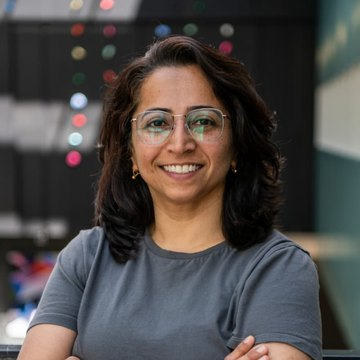

# optics.quriosity — Complete Guide

Everything about using, understanding and changing optics.quriosity, an open-access, browser-based simulator for programmable photonic arrays.

## What it is and how to start

optics.quriosity lets you build and run single-photon optics experiments on a grid, following the rules in the notes and the OpticalTable code (main.py). You place beam splitters, mirrors, phase shifters and detectors, send in photons, and watch the probabilities move step by step. Results agree with the original sympy code to about 10⁻¹⁶.

**Quick start**

1. Open the project folder (for example **optics.quriosity**) and double-click **index.html**. It opens in your web browser (Chrome, Edge, Firefox or Safari). Keep the folder together: the page needs the other files.
2. In the left sidebar, under **Experiments**, pick one, for example *Mach–Zehnder interferometer*.
3. Press **Play** at the bottom of the table. Orange lines show where the photon can be; the **Results** tab underneath shows how likely each detector is to click.

Nothing needs installing. Your work is remembered by the browser, so it is still there next time you open the page.

## A tour of the screen

The screen has five areas: the sidebar on the left, the top bar, the optical table in the middle, the analysis panel under it, and the details panel on the right.

| Area | Where | What it does |
| --- | --- | --- |
| Sidebar | Left | **Search** (Ctrl K) finds any command. **Experiments** opens a ready-made setup. **My setups** holds setups you saved with +. **Tools** picks what a click on the table does. At the bottom: **Settings**, **Guide** and **Theme**. |
| Top bar | Top | Where you are, grid size (columns × rows), Undo and Redo, the run status (click it to see any warnings), the formula in use, and **Export**. |
| Optical table | Middle | The grid with its components. Drag to move it, hold Ctrl and scroll to zoom, use the buttons at the top right to zoom or show a† labels. Hover anything for details. |
| Timeline | Bottom of the table | Play, pause, previous and next step, a slider for any step, and the playback speed. |
| Analysis panel | Under the table | Tabs: **Results**, **Evolution**, **Sweep**, **Python**, **Checks**. Drag its top edge to resize it, or fold it with the arrow. |
| Details panel | Right | Tabs: **Properties** (the selected node or detector, or a summary), **Input** (the photons you send in) and **Assistant** (the AI). |

On a small screen the sidebar opens from the menu button at the top left, and the panels stack below the table.

## Building your own experiment

Start from **Blank 4 × 4 table** (or any experiment), set the grid size in the top bar, then use the tools in the sidebar.

| Tool | Key | A click on the table… |
| --- | --- | --- |
| Select / edit | V | selects a node or detector so you can edit it on the right |
| Beam splitter 50:50 | B | turns a node into a 50:50 splitter (θ = 90°) |
| Mirror | M | turns a node into a mirror (θ = 180°) |
| Phase shifter | P | turns a node into a phase shifter (θ = 0°, φH = 90°) |
| Detector | D | places a detector on an edge, or removes it |
| Add photon | S | adds a photon on an edge to the input state |
| Erase | E | clears a node or removes a detector |

New splitters and mirrors face the direction chosen under **New parts face (θBS)** in the sidebar. Press **R** to rotate it, or to rotate the selected node.

**Editing a node.** Click it with Select. The Properties tab shows:

- **Label**: a name shown on the table, such as BS5.
- **Orientation θBS**: 0°, 90°, 180° or 270°. It decides the input sides and where the red tip sits.
- **Reflection θ**: 0° = nothing, 90° = 50:50, 180° = mirror. Reflectivity is R = sin²(θ/2).
- **Phase φH** and **Phase φV**: phases on the horizontal and vertical ports, in degrees.
- **Amplitudes**: the numbers the current formula gives, with a check that probability is conserved.

**Editing a detector.** Click it with Select to rename it or give it its own efficiency η (how often it counts a photon that reaches it).

**The input state.** Open the **Input** tab on the right. Write one term per line as `coefficient : photons`:

```
1 : h(1,2)+ v(0,3)+     # first pair
1 : v(2,1)+ h(3,0)+     # second pair
```

- `h(x,y)` is the horizontal edge entering node (x,y) from the left; `v(x,y)` the vertical edge entering it from below.
- `+` means the photon travels right or up; `-` means left or down.
- Coefficients can be numbers or formulas: `1/sqrt(2)`, `i`, `exp(i*pi/4)`.
- Text after `#` is a note. Leave **Normalise** on and the state is rescaled so the probabilities add up to 1.

**Saving.** Click **+** next to **My setups** to keep a named copy in this browser. Use **Export → Setup file (.json)** to keep a file you can send to someone or open on another computer.

## Reading the results

Every number in the analysis panel refers to the step shown on the timeline; move the slider to see earlier steps, or press End for the final result.

| Tab | What you see | How to use it |
| --- | --- | --- |
| Results | Click probability of each detector, joint outcomes (which detectors click together in one run), and a coincidence grid | The coincidence grid shows on its diagonal how often a detector clicks, and elsewhere how often two detectors click together. |
| Evolution | A chart of each detector's click probability step by step, plus the probability still “in flight” | Click the chart to jump to that step. Click a name under the chart to hide or show that line. |
| Sweep | Runs the experiment many times while one angle of one node changes, and plots every detector | Choose the node, the angle (θ, φH or φV) and the range, then **Run sweep**. The table beside it gives the fringe visibility V = (max − min) / (max + min). Click the chart to set the angle to that value. |
| Python | Code that rebuilds the setup with the OpticalTable class from main.py | Copy it into a notebook cell. Switch on **Include fix for main.py** if light hits a component from behind or leaves through the left or bottom edge. |
| Checks | Plain-language warnings and run details | Examples: light leaving through an edge with no detector, a custom formula that does not conserve probability, a run that hit the step limit. |

The **status** in the top bar sums up the checks: a green dot means every photon is accounted for and the total probability is 1. Detectors on the table also show their click probability as a percentage.

## The physics in plain words

Each node is a beam splitter described by four angles, exactly as in the notes; photons hop one edge per time step and split at every node they meet.

**The grid.** Nodes sit at whole-number points (x, y), x to the right and y upward. Light travels along the edges between nodes. The edge entering node (x,y) from the left is called h(x,y), and the one entering from below v(x,y), so the photon creation operators are a†h(x,y) and a†v(x,y), as in main.py.

**Drawing rules from the notes.**

| What you see | Meaning |
| --- | --- |
| Beam-splitter cube with a red corner | Beam splitter. The diagonal follows “/” (θBS 0°, 180°) or “\” (90°, 270°); the red corner marks the input side: θBS = 0° bottom-left, 90° top-left, 180° top-right, 270° bottom-right. “R 25%” under it shows the reflectivity when it is not 50:50. |
| Mirror plate | Mirror (θ = 180°), along the same diagonal, silvered side facing the light (both sides when light arrives from both) |
| Phase plate | Phase shifter (θ = 0° and φ ≠ 0°). A small phase plate at the corner of a splitter or mirror means it also adds a phase. |
| Small dot | Empty node (θ = 0° and φ = 0°): light passes straight through |
| Photodiode on an edge | Detector, facing the light that reaches it; a coloured halo grows with its click probability |
| Laser on an edge | Photon source: where an input photon starts, pointing along its path |
| Orange line with an arrow | Where a photon can be at this step; thicker means more likely |

The component drawings are from ComponentLibrary by Alexander Franzen (CC BY-NC 3.0) and live in `assets/components/`.

**What a beam splitter does.** A photon arriving at a node leaves either straight on (transmitted) or turned by 90° along the plate (reflected). With the default formula (the one in main.py):

<div class="formula">a†<sub>in</sub> → e<sup>iφ<sub>in</sub></sup> [ cos(θ/2) a†<sub>trans</sub> + i sin(θ/2) a†<sub>refl</sub> ]</div>

Here φ is φH for a photon arriving horizontally and φV for one arriving vertically. Light may enter any of the four sides: θBS 0° and 180° are the same “/” plate, 90° and 270° the same “\” plate. The red corner only marks the input side drawn in the notes.

**Probabilities.** The chance of an outcome is the squared size of its amplitude. When several identical photons share one mode, the probability gains a factor n! (n factorial). This is why two photons meeting on a 50:50 splitter always leave together (the Hong–Ou–Mandel effect).

**Time.** Each step moves every photon by one edge. A photon that reaches a detector is recorded with the step it arrived. Paths of different length therefore do not interfere, unless you switch timing to continuous wave (next section).

## Changing the formula and the simulation

Open **Settings** (bottom of the sidebar, or the formula button in the top bar, or the , key). Every change applies at once and can be undone with Ctrl Z.

**Settings → Formula** chooses how each node turns a photon into a transmitted and a reflected part.

| Formula | Transmitted amplitude | Reflected amplitude | When to use |
| --- | --- | --- | --- |
| Symmetric (default) | e^{iφ(in)} cos(θ/2) | i·e^{iφ(in)} sin(θ/2) | Matches main.py; the usual symmetric beam splitter |
| Real (Hadamard) | e^{iφH} cos(θ/2) for horizontal, −e^{iφV} cos(θ/2) for vertical | e^{iφ(in)} sin(θ/2) | Real-valued convention; at θ = 90° each node is a Hadamard gate |
| Phase after splitting | cos(θ/2) × phase of the outgoing direction | i·sin(θ/2) × phase of the outgoing direction | When φH and φV should act on the light leaving the node |
| Custom | your formula | your formula | Any other convention |

**Writing a custom formula.** Choose **Custom formula** and type four expressions: what a horizontally arriving photon gives when transmitted and when reflected, and the same for a vertically arriving photon. Use `th` for θ and `phH`, `phV` for the phases (in radians here), and `i`, `pi`, `sqrt()`, `exp()`, `cos()`, `sin()`, `tan()`, `conj()`. Example: `i*exp(i*phH)*sin(th/2)`. Buttons under the boxes fill in the built-in formulas as a starting point.

As you type, a badge tests your formula at 48 random angles. Green means it conserves probability (it is unitary). Red means probabilities will not add up to 1; the simulation still runs, and **Checks** shows a warning.

**Settings → Simulation**

- **Arrival time.** *Pulsed* keeps the arrival step of every detection, so different path lengths never interfere (as in main.py). *Continuous wave* ignores arrival times, so light reaching a detector at different steps interferes, as with a laser.
- **Photons.** *Identical photons* is normal quantum optics. *Distinguishable particles* labels each photon (γ1, γ2… in the order written on its input line); two-photon interference then disappears, which is a useful comparison.
- **Detector efficiency η.** The chance that a detector counts a photon that reaches it. Each detector can override it.
- **Maximum steps** (default 40) and **Ignore amplitudes below** (default 10⁻¹³) keep long runs fast.
- **Reset** returns the formula and simulation settings to the main.py defaults.

**Settings → Display** sets the theme (system, light, dark), how numbers are written (exact √2/2, decimal 0.7071 or polar 0.71∠90°), the a† labels and the legend.

## AI assistant and the free Groq key

The **Assistant** tab answers questions about your setup and can change it for you; it needs a free Groq API key, which takes about a minute to get.

**Get the key**

1. Go to [console.groq.com/keys](https://console.groq.com/keys) and sign in (a Google account works).
2. Click **Create API Key**, give it any name, and copy the key. It starts with `gsk_`.

**Add the key: choose one way**

- **In the app (recommended).** Settings → AI assistant → paste the key → **Save key**, then **Test the connection**. The key stays in this browser only.
- **In config.js.** Open `config.js` in Notepad, replace `PASTE_YOUR_GROQ_KEY_HERE` with your key (keep the quote marks), save, and refresh the page. Anyone who receives the folder can read a key written there, so remove it before sharing the folder.

**Using it.** Type a question and press Enter, or click a suggestion. The assistant receives a summary of the setup and its results, and can use tools: read the setup, change a node, place or remove a detector, replace the input state, resize the grid, or run a sweep. Each change shows as a blue tag above its answer and can be undone with Ctrl Z. Press the stop button to cancel.

Useful questions:

- “Explain this setup and what it demonstrates.”
- “Why does D1 never click?”
- “Set the phase of BS7 so that D8 clicks as often as possible.”
- “Add a 50:50 splitter at (1,1) and tell me what changes.”

**Models.** Choose in Settings → AI assistant. All are free with a Groq account.

| Model | Best for |
| --- | --- |
| llama-3.3-70b-versatile (default) | Good all-round answers and reliable tool use |
| openai/gpt-oss-120b | Harder reasoning questions |
| openai/gpt-oss-20b | Faster answers |
| llama-3.1-8b-instant | Fastest, simplest answers |

**Inside Claude.** When the simulator is opened from its Claude link, Claude blocks outside connections such as Groq. There the assistant uses Claude automatically and asks your permission the first time. The **Use** setting (Auto, Groq, Claude) lets you choose.

**If it does not answer**

| Message | What to do |
| --- | --- |
| Groq rejected the key | Copy the whole key again and save it. |
| The free Groq limit was reached | Wait a minute and try again. |
| This Groq model is not available | Pick another model in Settings. |
| Could not reach Groq | Check the internet connection. |

## Exports and Python

The **Export** button in the top bar saves your work as files or copies it as text.

| Export | File | Opens with | Use it to |
| --- | --- | --- | --- |
| Report | .md | Any text editor, Notion, GitHub | Share the setup, results, checks and Python code in one readable file |
| Results table | .csv | Excel, Google Sheets | Plot or analyse probabilities per step and the final joint outcomes |
| Table drawing | .svg | Browser, PowerPoint, Word, Inkscape | Put the optical table in a slide or paper; it stays sharp at any size |
| Setup file | .json | This simulator (Export → Open a setup file) | Keep a setup, send it to someone, or move it to another computer |
| Copy setup as text | — | Paste into a message | Share a setup without a file |
| Copy Python for main.py | — | Jupyter notebook | Re-run the same setup with the original OpticalTable code |

**Python for main.py.** The **Python** tab shows a notebook cell that sets `Theta_bs`, `Theta`, `PhiH`, `PhiV`, the detectors and the input state, then calls `Run_Experiment` and `Probabilities`. Notes at the top say when the simulator uses settings main.py does not have (another formula, continuous wave, distinguishable photons, efficiency below 1).

The original main.py has two known issues: light that reaches a component from behind stops it with an error, and light leaving through the left or bottom edge wraps around to the other side. Switch on **Include fix for main.py** to add a small patch that corrects both before the setup runs.

## Files and folders

The project is split by job, so the physics, the screen and your settings live in separate files; for normal use you only ever open **index.html** and, at most, **config.js**.

| File | What it does | Safe to edit? |
| --- | --- | --- |
| index.html | The page. Double-click to open the simulator. | No need |
| config.js | Your settings: Groq key, model, AI provider, starting experiment, theme, maximum steps, number format | **Yes** — this is the settings file |
| scripts/core/project-info.js | The About text: project description, team, vision, credits | **Yes** |
| styles/theme.css | Every colour and font, light and dark | Yes, to change colours |
| styles/components.css, layout.css, dialogs.css, canvas.css | Buttons, layout, windows and the table drawing | Rarely |
| assets/team/ | Team photos for the About page (square JPG, same file names) | Yes: replace a photo with one of the same name |
| assets/brand/ | The Quriosity logo and browser-tab icon (not covered by the MIT licence) | Replace a logo file, then run `python tools/build_brand.py` |
| assets/components/ | The component drawings (beam splitter, mirror, phase plate, photodiode, laser) | Yes: replace a drawing, then run `python tools/build_component_art.py` |
| scripts/core/math.js | Complex numbers, the formula reader, number formatting | No |
| scripts/core/formulas.js | The beam-splitter formulas and the unitarity check | Only to add a built-in formula |
| scripts/core/engine.js | The simulation itself and the result statistics | No |
| scripts/core/presets.js | The ready-made experiments | Only to add an experiment |
| scripts/core/exporters.js | Python, CSV and report files | No |
| scripts/ui/component-art.js | The drawings packed for the page (generated) | No: run `python tools/build_component_art.py` |
| scripts/ui/brand-art.js | The logo packed for the page (generated) | No: run `python tools/build_brand.py` |
| scripts/ui/*.js | Everything else on screen: table, panels, settings, assistant, search | No |
| scripts/app.js | Starts the app and connects the parts | No |
| tests/ | Automatic physics checks (`npm test` or `node tests/run-tests.js`) | Developers |
| docs/guide.html | This guide | — |
| docs/media/ | The introduction film, its poster, the README teaser and the animated diagram | Yes: replace with files of the same name |

Every file starts with a plain-English note saying what it does and whether you should touch it.

**config.js settings**

| Setting | Default | Meaning |
| --- | --- | --- |
| GROQ_API_KEY | PASTE_YOUR_GROQ_KEY_HERE | Your free Groq key (see the AI section). A key saved in the app wins. |
| GROQ_MODEL | llama-3.3-70b-versatile | Which Groq model answers |
| AI_PROVIDER | auto | auto, groq or claude |
| START_EXPERIMENT | wigner | First experiment shown: wigner, mzi, hom, bomb, bs, dc, qs or empty |
| THEME | system | system, light or dark |
| DEFAULT_MAX_STEPS | 40 | Steps before a run stops by itself |
| NUMBER_FORMAT | exact | exact, decimal or polar |

To edit: right-click config.js → Open with → Notepad, change the value between the quote marks, save, and refresh the page (F5). If the page then shows “config.js could not be read”, a quote mark or comma was removed: undo the last change.

**Where your work is kept.** The browser remembers the current setup, **My setups** and your preferences on this computer. Clearing the browser's site data erases them, so download important setups as .json files.

## Shortcuts, troubleshooting and limits

**Keyboard shortcuts** (when you are not typing in a box; on a Mac use ⌘ for Ctrl)

| Action | Key |
| --- | --- |
| Search and commands | Ctrl K |
| Select, splitter, mirror, phase, detector, photon, erase | V, B, M, P, D, S, E |
| Rotate θBS by 90° | R |
| Clear the selected node or detector | Delete |
| Play / pause | Space |
| Previous / next step, first / last step | ← →, Home End |
| Undo / redo | Ctrl Z / Ctrl Shift Z |
| Settings | , |
| Fit the table to the screen | 0 |
| Zoom / move the table | Ctrl + scroll / drag |

**Troubleshooting**

| Problem | Fix |
| --- | --- |
| The page is blank or says files are missing | Keep the whole folder together and open index.html from inside it. Unzip the folder first if it came as a .zip. |
| Status shows “Step limit” | Light is still moving after the maximum number of steps (common with loops). Raise Maximum steps in Settings → Simulation. |
| “Left the table” is above 0% | Some light leaves through an edge with no detector. Place a detector on that edge (Checks names it). |
| A red line under the input | The input text has a mistake; the message names the line. Modes look like `h(1,2)+`. |
| The total probability is not 1 | A custom formula is not unitary, the input is not normalised, or continuous-wave timing is on. Checks says which. |
| My setups disappeared | The browser's data was cleared, or another browser is open. Keep important setups as .json files. |
| The assistant does not answer | See the table in the AI section. |

**Accuracy.** For the Wigner's-friend and loop setups, every amplitude was compared term by term with the original sympy code (main.py); they agree to about 10⁻¹⁶. The standard results also come out exactly: Mach–Zehnder sends 100% to one port, Hong–Ou–Mandel gives ½ / ½, and the bomb tester gives ½, ¼, ¼.

**Limits.** The simulator handles path modes only. Polarisation optics (polarising splitters, wave plates, beam displacers), optical fibres that join distant points, and photon-pair sources such as BBO crystals are not modelled; sources are given directly as the input state. These are the next steps towards the full laboratory setup shown at the end of the notes.

## About us

**Programmable photonics, open to everyone.** optics.quriosity turns a browser into a quantum-optics laboratory. Lay out beam splitters, mirrors and phase shifters on a programmable grid, send in single photons, and follow the exact quantum state as it evolves, with no optical table, no special hardware and nothing to install.

We are physicists and software developers who want every researcher, teacher and student to be able to test an idea in quantum optics the moment they have it, and to understand what they see.

<div class="team-photos">
<figure><figcaption><b>Dr. Bindiya Arora</b><span>Group Leader &amp; Project Supervisor</span></figcaption></figure>
<figure><figcaption><b>Vipul Badhan</b><span>Project Lead &amp; Lead Physicist</span></figcaption></figure>
<figure><figcaption><b>Gurnoor Singh</b><span>Software &amp; Interface Development</span></figcaption></figure>
</div>

**Dr. Bindiya Arora** is Associate Professor of Physics at Guru Nanak Dev University, Amritsar, and Coordinator of its Centre for Quantum and Materials Science. After a PhD at the University of Delaware, she was a PSI Fellow at the Perimeter Institute for Theoretical Physics and Adjunct Faculty at the University of Waterloo. Her work covers theoretical atomic physics, quantum computation and computational methods for quantum technologies. She sets the project’s scientific direction.

**Vipul Badhan** is a PhD researcher in physics at Guru Nanak Dev University, working on computational atomic physics and quantum foundations. The platform began as his idea; he builds its physics framework and leads the implementation of quantum-optics experiments and protocols.

**Gurnoor Singh** designs and builds the software and the interface, turning the team’s scientific requirements into a clear, practical tool.

**Our vision.** We want exploring a photonic circuit to be as easy as sketching one, whether you are meeting interference for the first time or testing a scenario at the edge of quantum foundations. optics.quriosity is open by design and will grow with the people who use it: feedback from researchers, educators and industry decides what we build next.

Department of Physics, Guru Nanak Dev University, Amritsar, India.

**Licences.** Source code: MIT License. Component drawings: ComponentLibrary by Alexander Franzen, CC BY-NC 3.0. The Quriosity name and logo: all rights reserved (see assets/brand/LICENSE.md).
